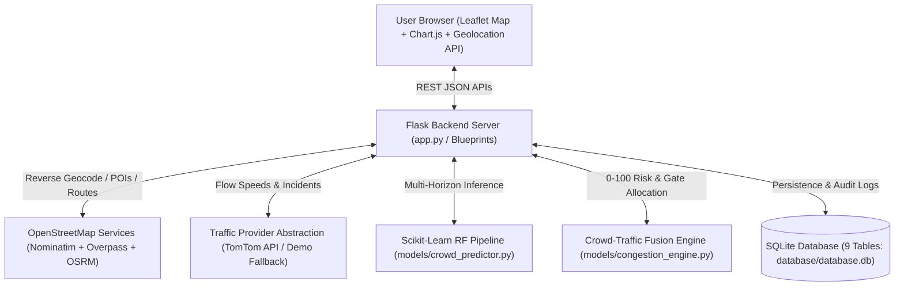

# CrowdCast AI — Location-Aware Intelligent Crowd & Traffic Prediction System

**CrowdCast AI** is a full-stack, location-aware geospatial intelligence, traffic monitoring, and machine learning prediction web application built with **Python (Flask)**, **Scikit-learn**, **SQLite**, **OpenStreetMap (Nominatim, Overpass API, OSRM)**, **TomTom Traffic API**, **Leaflet.js**, and **Chart.js**.

---

## Table of Contents

1. [Project Abstract](#1-project-abstract)
2. [Problem Statement](#2-problem-statement)
3. [Objectives](#3-objectives)
4. [Proposed Methodology](#4-proposed-methodology)
5. [System Architecture](#5-system-architecture)
6. [Module Explanations](#6-module-explanations)
7. [Data Integrity & Provenance Rules](#7-data-integrity--provenance-rules)
8. [Folder Structure](#8-folder-structure)
9. [Installation & Running Instructions](#9-installation--running-instructions)
10. [REST API Documentation](#10-rest-api-documentation)
11. [Testing Report](#11-testing-report)
12. [Future Enhancements](#12-future-enhancements)
13. [Final Project Presentation Outline](#13-final-project-presentation-outline)

---

## 1. Project Abstract

Urban university campuses, transit corridors, and commercial districts frequently experience sudden, severe bottlenecks when diurnal commuter peaks overlap with large-scale campus or public events (symposiums, technical festivals, admissions, sports tournaments). Existing navigation apps focus primarily on general vehicular routing and rarely account for upcoming localized institutional events, pedestrian surges at specific campus gates, or unmonitored collector roads.

**CrowdCast AI** bridges this gap by combining browser-based geolocation, OpenStreetMap surrounding-area recognition (11 road and POI categories across 500 m to 10 km radii), modular real-time traffic integration (TomTom Traffic API with a transparent demonstration fallback mode), a Scikit-learn Random Forest crowd forecasting engine (+15, +30, and +60 minute horizons), and a **Crowd–Traffic Fusion Engine** that computes a configurable **0–100 Congestion Risk Score** alongside smart route and campus entry-gate recommendations.

---

## 2. Problem Statement

1. **Lack of Event-Aware Micro-Scale Forecasting**: Standard traffic maps react after queues form on primary highways but do not proactively combine scheduled campus/venue visitor surges with nearby collector road capacities.
2. **Unmonitored Secondary Corridors**: Commercial traffic providers monitor major arterials (`primary`/`trunk`) while local campus ring roads and institutional gates remain unmonitored.
3. **Opaque Data Provenance in Academic Prototypes**: Many student dashboards hardcode static numbers or present simulated outputs as live GPS/traffic telemetry.
4. **Uneven Gate Utilization**: During large campus events, 70–80% of vehicles converge on a single main arch gate while secondary gates operate below capacity.

---

## 3. Objectives

1. **Automatic & Privacy-Conscious Location Recognition**: Acquire user coordinates via the W3C Browser Geolocation API on explicit user consent (with manual search fallback if denied) and reverse-geocode into city, locality, and street context.
2. **Surrounding Area Recognition**: Query OpenStreetMap (Overpass API) within user-selectable radii (`500m`, `1km`, `2km`, `5km`, `10km`) to identify main roads, secondary roads, intersections, traffic junctions, colleges/schools, bus stops, railway stations, hospitals, commercial areas, event venues, and parking areas.
3. **Modular Real-Time Traffic Integration**: Integrate TomTom Traffic Flow & Incident APIs behind a clean provider abstraction (`BaseTrafficProvider`), classifying road segments into **Green (Low)**, **Yellow (Moderate)**, **Orange (Heavy)**, and **Red (Severe)** congestion, with an explicitly labelled Demonstration Mode when API credentials are absent.
4. **Machine Learning Crowd Prediction**: Train a Scikit-learn `RandomForestRegressor` and `RandomForestClassifier` pipeline on a documented synthetic dataset (`ml/dataset.csv`) using strict train/test split ordering before feature scaling/encoding to forecast current, +15m, +30m, and +60m crowd trends.
5. **Crowd–Traffic Fusion Engine**: Combine traffic flow (35%), expected crowd (30%), historical diurnal patterns (20%), and event impact (15%) into a 0–100 Congestion Risk Score with location-specific recommendations.
6. **Smart Route & Campus Gate Allocation**: Use OSRM geometric routing and gate capacity balancing to recommend optimal arrival windows, alternative corridors, and campus entry gates.

---

## 4. Proposed Methodology

1. **Geospatial Ingestion Layer**:
   - Browser `navigator.geolocation.getCurrentPosition()` captures WGS84 `(latitude, longitude)` upon user request.
   - `services/geocoding_service.py` resolves human-readable locality metadata via OpenStreetMap Nominatim.
   - `services/nearby_places_service.py` queries Overpass API for ways and nodes, computes Haversine distances, estimates lane capacities (`capacity_vph`), and identifies multi-corridor intersections.
2. **Traffic Telemetry & Fallback Layer**:
   - `services/traffic_service.py` checks `TOMTOM_API_KEY`. When configured, it fetches live segment speeds and incidents. When unconfigured, `DemonstrationTrafficProvider` generates time-synchronized sample observations anchored to the actual detected nearby roads and marks `is_simulated = True` and `data_source = "demonstration_sample_traffic"`.
3. **ML Forecasting Layer**:
   - `ml/train_model.py` splits the 1,800-sample synthetic dataset (`80%` train / `20%` test) **before** fitting the `ColumnTransformer` (`SimpleImputer` + `StandardScaler` for numeric features; `OneHotEncoder` for `event_type`).
   - Multi-output `RandomForestRegressor` predicts `[current, +15m, +30m, +60m]` headcounts; `RandomForestClassifier` predicts congestion severity (`Low`, `Moderate`, `Heavy`, `Severe`). Ensemble tree agreement across the 120 trees provides an interpretable stability metric.
4. **Crowd–Traffic Fusion & Decision Layer**:
   - `models/congestion_engine.py` normalizes four sub-scores (Traffic, Crowd, Historical Diurnal Curve, Event Surge) plus a Volume-to-Capacity (`V/C`) modifier for nearby road segments into a `0–100` score and allocates incoming demand proportionally across open campus gates.

---

## 5. System Architecture



---

## 6. Module Explanations

1. **Location & Geocoding Module (`services/location_service.py`, `services/geocoding_service.py`)**: Validates coordinates (`-90..90`, `-180..180`, rejects Null Island `0,0`), enforces allowed search radii (`500m`–`10km`), performs Nominatim reverse/forward geocoding, and stores only coarse area context (`3` decimal places) in SQLite to protect user privacy.
2. **Surrounding Area Recognition Module (`services/nearby_places_service.py`)**: Extracts 11 infrastructure categories from OpenStreetMap Overpass API, distinguishes provider-monitored primary roads from unmonitored secondary roads, and identifies spatial choke points.
3. **Modular Traffic Service (`services/traffic_service.py`)**: Implements `BaseTrafficProvider`, `TomTomTrafficProvider`, and `DemonstrationTrafficProvider`. Classifies congestion ratios into Green, Yellow, Orange, and Red indicators.
4. **ML Crowd Prediction Engine (`ml/train_model.py`, `models/crowd_predictor.py`)**: Scikit-learn pipeline predicting current, +15m, +30m, and +60m crowd counts, full-day diurnal curves, peak windows, and tree-variance confidence.
5. **Crowd–Traffic Fusion Engine (`models/congestion_engine.py`)**: Combines traffic, crowd, historical patterns, and event surges using documented, runtime-configurable weights.
6. **Event-Aware Prediction Module (`routes/event_routes.py`)**: Full CRUD for 7 event categories (`College symposiums`, `Technical festivals`, `Sports events`, `Public gatherings`, `College admissions`, `Seminars`, `Cultural events`) with side-by-side Normal Baseline vs. Event-Day hourly comparisons.
7. **Smart Route & Gate Recommendation Module (`services/routing_service.py`)**: Queries OSRM for alternative driving geometries, overlays corridor congestion risk, computes optimal arrival windows, and balances load across registered campus gates.
8. **Administration & Reporting Module (`routes/admin_routes.py`, `routes/report_routes.py`)**: Werkzeug password-hashed admin login, campus/gate registration, runtime weight tuning, ML retraining, and downloadable CSV reports.

---

## 7. Data Integrity & Provenance Rules

CrowdCast AI strictly separates and badges three categories of information across the UI, database, and CSV exports:
- **Real Data (`badge-real`)**: Browser W3C GPS coordinates, OpenStreetMap Nominatim reverse geocoding, Overpass API road/POI geometries, OSRM road network geometry, and live TomTom API observations (when `TOMTOM_API_KEY` is provided).
- **Estimated Data (`badge-estimated`)**: Scikit-learn Random Forest crowd predictions (explicitly labelled as trained on `ml/dataset.csv` synthetic data), road capacity (`V/C`) estimates on unmonitored collector roads, and 0–100 Fusion Risk Scores.
- **Demonstration Data (`badge-demo`)**: Sample traffic flow speeds and incidents used when `TOMTOM_API_KEY` is not configured (`is_simulated = True`, `data_source = "demonstration_sample_traffic"`), and offline fallback topology when Overpass/OSRM network access is unavailable.

---

## 8. Folder Structure

```text
CrowdCast-AI/
├── app.py                          # Main Flask application entry point
├── config.py                       # Environment configuration & default constants
├── requirements.txt                # Python package dependencies
├── .env.example                    # Template environment variables
├── database/
│   ├── db.py                       # SQLite schema initialization (9 tables) & seeding
│   └── database.db                 # SQLite relational database
├── models/
│   ├── crowd_predictor.py          # Scikit-learn Random Forest inference wrapper
│   └── congestion_engine.py        # 0-100 Crowd-Traffic Fusion Risk Engine
├── services/
│   ├── location_service.py         # Coordinate/radius validation & privacy-safe storage
│   ├── geocoding_service.py        # OpenStreetMap Nominatim reverse & manual search
│   ├── nearby_places_service.py    # Overpass API 11-category area recognition & analysis
│   ├── traffic_service.py          # TomTom API & Demonstration Fallback provider abstraction
│   └── routing_service.py          # OSRM alternative routing & smart gate allocation
├── routes/
│   ├── location_routes.py          # /api/location/* endpoints
│   ├── traffic_routes.py           # /api/traffic/* endpoints
│   ├── prediction_routes.py        # /api/prediction/* endpoints
│   ├── event_routes.py             # /api/events/* endpoints
│   ├── report_routes.py            # /api/reports/* & CSV export endpoints
│   └── admin_routes.py             # /api/admin/* authentication & management endpoints
├── ml/
│   ├── train_model.py              # Synthetic dataset generator & RF training pipeline
│   ├── dataset.csv                 # 1,800-row synthetic demonstration dataset
│   └── saved_model/
│       ├── crowd_model.joblib      # Serialized Scikit-learn pipelines
│       └── model_metadata.json     # Holdout metrics & dataset provenance metadata
├── templates/
│   ├── base.html                   # Shared smart-city dashboard shell & status bar
│   ├── index.html                  # A. Home Page
│   ├── dashboard.html              # B. Live Location Dashboard
│   ├── traffic.html                # C. Live Traffic Map
│   ├── prediction.html             # D. Crowd Prediction Page
│   ├── events.html                 # E. Event Management Page
│   ├── congestion.html             # F. Congestion Risk Analysis & Routing Page
│   ├── reports.html                # G. Analytical Reports & CSV Download Page
│   └── admin.html                  # H. Administration Module Page
├── static/
│   ├── css/style.css               # Responsive Dark/Light smart-city stylesheet
│   └── js/app.js                   # Geolocation, theme, and state synchronization
├── tests/
│   └── test_crowdcast.py           # Comprehensive Pytest verification suite
└── README.md                       # Complete documentation & deliverables
```

---

## 9. Installation & Running Instructions

### Step 1: Create and Activate Virtual Environment

```powershell
python -m venv .venv
.venv\Scripts\activate
```

### Step 2: Install Dependencies

```powershell
pip install -r requirements.txt
```

### Step 3: (Optional) Configure Environment Variables

Copy `.env.example` to `.env`. Leave `TOMTOM_API_KEY` empty to test in clearly-labelled **Demonstration Mode**, or supply your TomTom API key for live traffic telemetry:

```powershell
copy .env.example .env
```

### Step 4: Train / Verify the Machine Learning Model

```powershell
python ml/train_model.py
```

### Step 5: Start the Development Server

```powershell
python app.py
```

Open your browser at:
**http://127.0.0.1:5000**

*(Note: Browser Geolocation requires a secure context—always access via `http://127.0.0.1:5000` or `http://localhost:5000` or `https://`.)*

### Production Deployment (WSGI Server)

Do not use Flask's built-in development server in production. On Windows/Linux, run with **Waitress** (included in `requirements.txt`):

```powershell
waitress-serve --host=127.0.0.1 --port=5000 app:app
```

---

## 10. REST API Documentation

| Method | Endpoint | Description |
| :--- | :--- | :--- |
| `GET` | `/api/health` | System health, 9 SQLite tables check, ML model status, and provider mode |
| `POST` | `/api/location/detect` | Validate `(latitude, longitude, radius_m)` and reverse-geocode into address & locality |
| `GET` | `/api/location/nearby` | Query 11 surrounding road & POI categories (`?lat=...&lon=...&radius_m=1000`) |
| `GET` | `/api/location/search` | Manual forward-geocoding location search (`?q=Chennai`) when GPS is denied |
| `GET` | `/api/traffic/current` | Retrieve road speeds, delays, and Green/Yellow/Orange/Red congestion levels |
| `GET` | `/api/traffic/incidents` | Retrieve nearby traffic incidents with explicit live vs. demo provenance tags |
| `POST` | `/api/prediction/crowd` | Run Scikit-learn RF crowd forecast (`current`, `+15m`, `+30m`, `+60m`, peak window) |
| `POST` | `/api/prediction/congestion` | Calculate 0–100 Crowd–Traffic Fusion Risk Score, contributing factors, and OSRM routes |
| `GET` | `/api/events` | List all events with Normal Baseline vs. Event-Day impact comparisons |
| `POST` | `/api/events` | Create a new event and compute its traffic & crowd impact |
| `PUT` | `/api/events/<id>` | Update an existing event by ID |
| `DELETE` | `/api/events/<id>` | Delete an event by ID |
| `GET` | `/api/reports/summary` | Consolidated JSON report across location, traffic, crowd predictions, and events |
| `GET` | `/api/reports/csv` | Download complete multi-section analytical CSV report |
| `POST` | `/api/admin/login` | Authenticate administrator against hashed password in SQLite |
| `POST` | `/api/admin/gates` | Register a new campus entry/exit gate with hourly capacity |
| `POST` | `/api/admin/dataset/retrain` | Regenerate synthetic dataset and retrain the Random Forest model |

---

## 11. Testing Report

Run the automated test suite via Pytest:

```powershell
python -m pytest tests/test_crowdcast.py -v
```

| Test Case | Module Verified | Result |
| :--- | :--- | :--- |
| `test_health_and_database_initialization` | Server startup, `/api/health`, all 9 SQLite tables initialized | **PASSED** |
| `test_all_website_pages_render` | All 8 HTML pages (`/`, `/dashboard`, `/traffic`, `/prediction`, `/events`, `/congestion`, `/reports`, `/admin`) | **PASSED** |
| `test_location_detection_and_validation` | Coordinate validation, Null Island `(0,0)` rejection, reverse geocoding | **PASSED** |
| `test_manual_location_search` | Manual text search fallback when browser GPS is denied | **PASSED** |
| `test_nearby_place_and_road_recognition` | All 11 road & POI categories + nearby-area choke point analysis | **PASSED** |
| `test_traffic_integration_and_fallback_mode` | Modular traffic service, Green/Yellow/Orange/Red classification, demo mode tags | **PASSED** |
| `test_ml_crowd_prediction_api` | Random Forest `+15m`/`+30m`/`+60m` forecasts & synthetic dataset provenance | **PASSED** |
| `test_event_crud_and_impact_analysis` | Event creation, update, deletion, Normal vs. Event-Day surge calculation | **PASSED** |
| `test_congestion_fusion_risk_score_and_routing` | 0–100 Fusion Risk Score, ranked contributing factors, OSRM routes & gates | **PASSED** |
| `test_reports_summary_and_csv_export` | JSON summary report & downloadable CSV attachment generation | **PASSED** |
| `test_admin_authentication_and_gate_registration` | Werkzeug password-hash verification & campus gate registration | **PASSED** |

---

## 12. Future Enhancements

1. **Field Sensor & CCTV/Wi-Fi Probe Calibration**: Replace the synthetic demonstration dataset with anonymized campus Wi-Fi access-point association counts and inductive loop detectors for real-world supervised calibration.
2. **GTFS-Realtime Public Transit Integration**: Incorporate live municipal bus and metro arrival feeds at nearby stops to refine short-term pedestrian surge windows.
3. **Spatio-Temporal Graph Neural Networks (ST-GNN)**: Extend the baseline Random Forest model to a Graph Attention Network over the exact OpenStreetMap road adjacency matrix.
4. **Automated Gate Digital Signage Webhook**: Push advisory gate load-balancing percentages to variable message signs (VMS) along campus approach corridors.

---

## 13. Final Project Presentation Outline

1. **Slide 1 — Title & Vision**: *CrowdCast AI: Location-Aware Intelligent Crowd & Traffic Prediction System*.
2. **Slide 2 — Problem & Motivation**: Why standard navigation apps fail during localized campus symposiums, admissions, and stadium events.
3. **Slide 3 — System Architecture**: End-to-end flow from Browser Geolocation & OpenStreetMap Overpass to TomTom Traffic, Scikit-learn RF, and the 0–100 Fusion Engine.
4. **Slide 4 — Surrounding Area Recognition**: Live demonstration of 11-category road/intersection/POI discovery across 500m–10km radii.
5. **Slide 5 — Modular Traffic Service & Data Honesty**: How Real, Estimated, and Demonstration data are cleanly separated and badged.
6. **Slide 6 — Machine Learning Pipeline**: Feature engineering, strict train/test split before preprocessing, +15/+30/+60m crowd horizon predictions, and ensemble tree agreement.
7. **Slide 7 — Core Innovation: Crowd–Traffic Fusion Engine**: Configurable weighting (35% Traffic, 30% Crowd, 20% Historical, 15% Event) and Volume-to-Capacity road risk scoring.
8. **Slide 8 — Smart Route & Campus Gate Allocation**: OSRM geometric routing overlaid with corridor risk and proportional campus gate load balancing.
9. **Slide 9 — Live Full-Stack Demo & Testing Results**: Walkthrough of all 8 pages, REST APIs, and 100% passing Pytest suite.
10. **Slide 10 — Conclusion & Future Scope**: Summary of achievements and roadmap for IoT/GTFS-RT field deployment.

